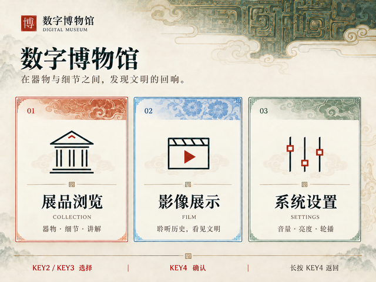
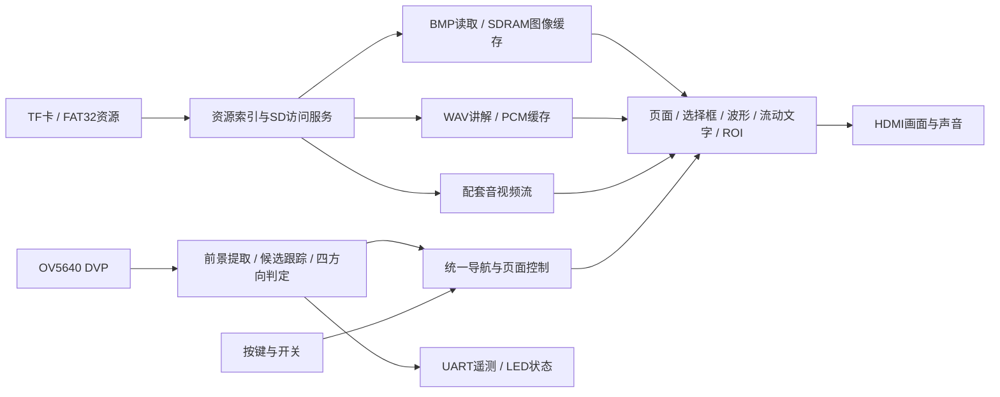
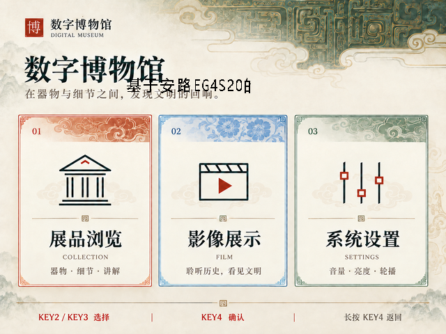

# 基于安路EG4S20的FPGA博物馆播放与交互系统

基于 Anlogic EG4S20（EG4S20BG256）的数字博物馆多媒体互动导览终端，集成展品图文浏览、音视频讲解、按键与四方向手势交互。

系统面向博物馆、展览馆的自主导览场景，适合固定放置在展品旁的导览台上。游客可以观看实物，再通过终端查阅图片与文字、收听讲解、观看短片，并选择按键或手势操作。

本 README 介绍整个系统的功能与使用方式；具体版本修改、测试记录和构建证据见文末交付章节。

## 目录导航

- [完整功能总览](#完整功能总览)
- [页面与参观流程](#页面与参观流程)
- [按键与开关](#按键与开关)
- [手势交互](#手势交互)
- [音视频与可视化](#音视频与可视化)
- [系统设置与自动运行](#系统设置与自动运行)
- [流动文字信息层](#流动文字信息层)
- [硬件与系统结构](#硬件与系统结构)
- [TF卡与内容资源](#tf卡与内容资源)
- [诊断与状态反馈](#诊断与状态反馈)
- [上手步骤](#上手步骤)
- [固件下载](#固件下载)
- [验证结果](#验证结果)
- [编译和仿真](#编译和仿真)

## 完整功能总览

| 功能模块 | 系统已接入的能力 |
|---|---|
| 开机展示与照片轮播 | 13张展品照片、自动或手动切图、淡出/加载/淡入、照片计数与展品关联 |
| 照片放大 | 在按键模式的轮播页进入2×放大，并可调整到4×，退出或超时后恢复普通显示 |
| 首页导航 | 展品浏览、影像展示、系统设置三个入口，动态焦点选择 |
| 展品图文 | 四件展品列表、单件详情、中文说明，前后切换展品 |
| 独立音频讲解 | 每件展品对应独立WAV，进入讲解页自动播放，支持暂停、继续、换件及结束后重播 |
| 影像展示 | 配套固定音视频流的播放、暂停与继续，通过HDMI输出画面和声音 |
| 讲解波形 | 根据实际音量缩放后的PCM生成波形；暂停冻结，换件清空，视频页不显示讲解波形 |
| 实体操作 | KEY2/KEY3选择，KEY4短按确认、长按返回；手势模式下按键切换为摄像头专用控制 |
| 手势操作 | 摄像头前景提取、候选目标跟踪、四方向滑动判定、起手/回中确认、页面导航事件输出 |
| 摄像头预览 | 右上角RGB ROI窗口、起手/回中四角判定框、诊断掩膜视图与中文状态提示 |
| 系统设置 | 音量、输出画面亮度、5～60秒轮播间隔、自动轮播开关 |
| 空闲管理 | 按键模式下指定页面40秒无操作返回轮播；讲解页不受此自动返回影响，手势模式取消空闲返回 |
| 流动信息 | 指定系统名称在小窗口内向左循环，窗口同时沿屏幕飘动，SW1控制显隐 |
| 存储与缓存 | FAT32资源挂载、文件名索引、BMP读取、SDRAM图像缓存、音频FIFO与SD访问协调 |
| 调试与反馈 | HDMI状态提示、4路LED状态输出、115200串口识别与故障遥测 |

上述“已接入”指当前交付源码中的实现。功能实现、历史回归、本次专项验证和新版实板验收的边界见[验证结果](#验证结果)。

## 页面与参观流程

### 1. 开机轮播

复位后进入照片轮播页，展示13张展品照片。照片按四件展品组织，切换过程采用淡出、加载完成后淡入。SW4与设置菜单共同决定是否自动切图；关闭自动轮播后仍可手动浏览。

按键模式下可对照片进行2×/4×放大。放大期间暂停自动切图，5秒无操作自动恢复普通比例；按KEY4短按也可主动退出放大。KEY4长按进入首页。手势模式下，左右滑动切图，下滑或上滑进入首页。

### 2. 首页

首页包含三个入口：

| 入口 | 用途 |
|---|---|
| 展品浏览 | 进入四件展品列表，查看详情并进入独立讲解 |
| 影像展示 | 进入配套短片页面，确认后开始音视频播放 |
| 系统设置 | 调节音量、画面亮度、轮播间隔和自动轮播 |

下图是首页背景素材示例，不含运行时的选择框、摄像头、波形和流动文字叠加：



### 3. 展品列表、详情与讲解

当前内容示例包含：

| 展品 | 独立讲解文件 | 对应轮播照片数 |
|---|---|---|
| 青铜方鼎 | `AUD00001.WAV` | 3 |
| 青花瓷瓶 | `AUD00002.WAV` | 3 |
| 汉代玉璧 | `AUD00003.WAV` | 4 |
| 唐代陶俑 | `AUD00004.WAV` | 3 |

标准浏览路径：**首页 → 展品列表 → 展品详情 → 音频讲解**。详情页与讲解页均可前后切换展品；进入讲解页并完成资源就绪后自动开始对应音轨。讲解页返回时回到展品列表，并停止该讲解。

### 4. 影像展示

从首页进入后，确认开始播放配套音视频流；再次确认可暂停或继续。返回后退出影像页。短片采用匹配工程格式与资源清单的 `AVVIDEO.BIN`，由FPGA组织读取、缓存和HDMI音视频输出。

## 按键与开关

### 板载开关

| 开关 | 功能 | 说明 |
|---|---|---|
| SW1 | 流动文字显隐 | 控制整个信息层；关闭时内部运动状态仍继续 |
| SW2 | 摄像头预览显隐 | 只控制预览显示，不代替SW3识别开关 |
| SW3 | 手势模式 | 开启后自动执行准备流程，并将KEY2/3/4交给摄像头控制 |
| SW4 | 允许自动轮播 | 需与设置菜单中的自动轮播同时开启；关闭不影响手动切图 |

### 按键模式：SW3关闭

| 场景 | KEY2 | KEY3 | KEY4短按 | KEY4长按 |
|---|---|---|---|---|
| 普通轮播 | 下一张 | 上一张 | 进入2×放大 | 首页 |
| 放大查看 | 增大至4× | 减小至2× | 退出放大 | 首页 |
| 首页/展品列表 | 下一项 | 上一项 | 进入所选项 | 返回/首页 |
| 展品详情 | 下一件 | 上一件 | 进入讲解 | 返回列表 |
| 音频讲解 | 下一件 | 上一件 | 暂停/继续；结束后重播 | 返回列表并停止讲解 |
| 影像展示 | — | — | 开始/暂停/继续 | 返回首页 |
| 系统设置 | 下一项；编辑时增加/切换 | 上一项；编辑时减少/切换 | 进入/完成编辑 | 退出编辑；非编辑时返回首页 |

菜单按键采用同步与消抖，KEY4短按在释放时形成确认事件，长按约600ms触发返回。系统复位通过 `sys_rst_n` 接口进入，与菜单按键区分。

### 手势模式：SW3开启

| 按键 | 摄像头模式用途 |
|---|---|
| KEY2 | 重新准备背景；按提示先将手移开 |
| KEY3 | 重新起手，清除当前识别进程并返回搜索/确认流程 |
| KEY4 | RGB预览与掩膜诊断切换；诊断期间暂停手势导航 |

手势模式下KEY4不执行菜单确认或长按返回。关闭SW3后，按键在释放并稳定后交回菜单，避免切换模式时误触发。

## 手势交互

### 操作方法

1. 固定设备及摄像头朝向，开启SW3；需要观察画面时开启SW2。
2. 按提示将手移开，等待背景准备。
3. 将手部候选目标的中心放入四角框所示区域，短暂停稳。
4. 看到“可以滑动了”后，向左、右、上或下滑动，并在末端停稳。
5. 动作完成后回到中间，重新停稳，再进行下一次滑动。

| 方向 | 页面行为 |
|---|---|
| 左滑 | 上一项、上一张或上一件；设置编辑时减少/切换 |
| 右滑 | 下一项、下一张或下一件；设置编辑时增加/切换 |
| 下滑 | 确认进入、开始/暂停/继续、进入/完成设置编辑；轮播页下滑进入首页 |
| 上滑 | 返回；设置编辑时退出编辑 |

功能随当前页面变化，与页面提示相对应。照片放大通过按键模式操作，手势模式没有额外的捏合缩放识别。

### 判定范围与状态

预览为右上角 **128×112像素** RGB ROI窗口，四角框覆盖 **34×30像素**。四角框对应算法坐标 `256≤cx≤384`、`184≤cy≤296`，判断候选目标中心是否进入起手/回中范围，不要求整只手都装进框内。开始滑动后允许离开该内框。

识别阶段为 **搜索 → 连续确认 → 可滑动 → 跟踪 → 回中**。当前使用3个通过条件检查的新样本完成起手确认，并检查目标有效性、尺寸、边缘裁切、稳定性、轨迹关联及滑动末端条件；重复帧不增加确认计数。

| 提示类别 | 典型显示 |
|---|---|
| 准备 | 请先移开手、正在准备 |
| 起手 | 请将手居中、请稍停片刻、可以滑动了 |
| 动作与回中 | 正在识别、请回中停稳、请向中央收手 |
| 页面/诊断 | 页面加载中、手势调试 |
| 无数据或故障 | 暂无画面、图像流异常、操作暂不可用 |

本识别器实现四方向目标运动导航，不提供复杂手语、手指关节模型或实际展品指向识别。帧处理、光照、背景和手部运动会影响实际效果，现场使用需配合正确准备。

## 音视频与可视化

- **独立语音讲解：**四件展品分别读取独立音轨。WAV格式为RIFF/WAVE、48kHz、16位有符号小端PCM、单声道，运行时送入HDMI音频链路。
- **音轨控制：**进入讲解页自动播放；支持暂停、继续、换件和播放结束后重播。离开讲解页停止音轨。
- **实际PCM波形：**从音量缩放后的实际采样生成波形，显示在讲解简介下方；暂停冻结，换件清空，短片页隐藏。该波形是时域音频可视化。
- **短片播放：**使用配套 `AVVIDEO.BIN`，支持音视频输出、暂停和继续。
- **音量调节：**对输出PCM进行数字缩放，适用于讲解与短片音频。
- **缓存与衔接：**媒体读取、图像缓存、音频FIFO及SD请求协调由FPGA模块完成；页面切换与资源加载通过握手衔接。

## 系统设置与自动运行

| 设置/行为 | 当前规则 |
|---|---|
| 音量 | 0～100%，默认100%；内部范围0～256，单次调整16 |
| 画面亮度 | 对输出RGB做数字亮度缩放，默认100%；内部范围16～256，单次调整16，保留非零最低亮度 |
| 轮播间隔 | 5～60秒，默认5秒，单次调整1秒 |
| 自动轮播 | 菜单开关与SW4共同控制；两者均开启才自动切图 |
| 图片过渡 | 淡出、等待新图加载、淡入；设置间隔之外还存在切图过程耗时 |
| 放大超时 | 放大状态5秒无操作恢复普通比例，再按轮播条件运行 |
| 空闲返回 | 按键模式下，除轮播页与讲解页，其他页面默认40秒无操作返回轮播 |
| 手势模式空闲 | 不自动超时返回轮播；关闭手势模式后重新计算完整空闲间隔 |

## 流动文字信息层

显示内容固定为：

> 基于安路EG4S20的FPGA博物馆播放与交互系统

文字视窗 **179×24像素**、外框 **195×32像素**，黑字透明背景。每60个显示帧向左移动25像素，标称60Hz下约25像素/秒；句首停留60帧，句尾留24像素空隙后循环。整窗每3帧移动1像素并碰边反弹，SW1控制显隐。

流动信息层与菜单、讲解、短片共同工作，媒体暂停不停止该信息层。当前右侧反弹边界为x=445，避免加宽外框越出屏幕。

## 硬件与系统结构

| 部件/接口 | 用途 |
|---|---|
| Anlogic EG4S20 / EG4S20BG256 | 承载存储、页面、媒体、手势及显示控制逻辑 |
| HDMI显示设备 | 640×480、约60Hz画面与48kHz音频输出 |
| TF/SD卡 | FAT32存储界面、照片、独立讲解与配套音视频流 |
| SDRAM缓存 | 图像帧存储及读取服务 |
| OV5640 DVP摄像头 | 摄像头配置、像素采集、ROI与前景分析输入 |
| KEY2/3/4、SW1～SW4 | 菜单操作、模式控制及功能开关 |
| UART_TX及USB转TTL串口 | 输出识别和故障诊断信息 |
| 4路LED | 背景就绪、候选目标、可滑动及故障状态反馈 |

系统组织关系：



当前完整集成顶层为 [museum_phase6_unified_top.v](phase6_gallery/camera/rtl/museum_phase6_unified_top.v)，相应引脚与时序约束为 [unified.adc](phase6_gallery/camera/constraints/unified.adc) 和 [unified.sdc](phase6_gallery/camera/constraints/unified.sdc)。接线按这些文件和实际开发板确认，不套用历史版本引脚配置。

## TF卡与内容资源

资源放在配套FAT32卡根目录，按文件名建立索引，不依赖复制顺序。工程支持MBR分区FAT32及相应无分区FAT32布局，实际媒体必须与当前解析器和资源清单匹配。

| 文件 | 内容 |
|---|---|
| `IMG00001.BMP`～`IMG00004.BMP` | 保留的兼容基础资源，同样属于29图完整索引要求 |
| `IMG00005.BMP` | 首页 |
| `IMG00006.BMP` | 展品列表 |
| `IMG00007.BMP`～`IMG00010.BMP` | 四件展品详情 |
| `IMG00011.BMP`～`IMG00014.BMP` | 四件展品讲解页 |
| `IMG00015.BMP` | 系统设置 |
| `IMG00016.BMP` | 影像展示页 |
| `IMG00017.BMP`～`IMG00029.BMP` | 13张轮播照片 |
| `AUD00001.WAV`～`AUD00004.WAV` | 四件展品独立讲解 |
| `AVVIDEO.BIN` | 配套固定音视频流 |

当前BMP资源采用640×480、24位无压缩格式，WAV采用上述48kHz/PCM16/单声道格式。完整29张BMP应同时保留，缺失必需图片会触发索引错误。更换媒体时需遵循对应格式和索引，不只修改扩展名。

本仓库包含素材源文件、工具和资源说明，完整可用TF卡仍需使用已有配套资源。固件ZIP不能替代整套TF卡。部分历史资源脚本对应早期界面，重建前需核对其输入与当前资源版本。

内容与来源说明见 [展品文稿](phase6_gallery/assets/base_pages/EXHIBITS.md)、[轮播素材来源](phase6_gallery/GALLERY_SOURCES.md)、[资源清单](phase6_gallery/ASSETS.json)。

## 诊断与状态反馈

### 串口遥测

UART采用 **115200 / 8N1 / 无流控**。FPGA **D12 UART_TX → USB转TTL串口RXD**，双方共地，使用兼容3.3V逻辑的TTL接口。当前FPGA接口用于发送遥测，不是上位机控制通道。

| 字段 | 含义 |
|---|---|
| `F` | 已分析帧编号，用于观察分析是否推进 |
| `S` / `R` | 识别阶段 / 当前拒绝或退出原因 |
| `P` / `V` / `N` | 当前建议方向 / 最近提交方向 / 已提交事件计数 |
| `M` | 可滑动、目标可见、候选有效、ROI裁切标志 |
| `C` / `W` / `A` | 候选中心、宽高、区域面积 |
| `E` | ROI触边标志 |
| `K` | 背景就绪、源故障、导航溢出、DVP锁定四项标志 |

数值采用十六进制。背景就绪、DVP锁定且无源故障/导航溢出时，预期 `K=9`；它不单独代表手势已确认。完整格式见 [camera_telemetry_uart.v](phase6_gallery/camera/rtl/camera_telemetry_uart.v)。

### LED与故障提示

| 逻辑输出 | 含义 |
|---|---|
| LED[0] | 背景就绪 |
| LED[1] | 候选目标可见 |
| LED[2] | 已起手/正在跟踪，可滑动状态 |
| LED[3] | 图像源故障或导航溢出 |

LED实际亮灭电平以开发板电路为准。“图像流异常”表示源流错误标志，可能来自FIFO溢出、帧采样计数异常或处理等待超时；“暂无画面”与“页面加载中”分别表示其他状态。本版已修复准备期间停止读取FIFO导致的已复现溢出问题，但仍保留真实故障上报，不能以重新准备背景代替系统故障复位。

## 上手步骤

1. 接好HDMI显示与音频输出、配套TF卡、摄像头及必要供电；按当前约束确认引脚。
2. 使用本仓库交付bit加载FPGA，复位后检查轮播页及资源读取状态。
3. 先在SW3关闭时验证KEY2/3/4，进入首页、四件展品、讲解、影像与设置页。
4. 用SW4和菜单检查自动轮播，验证2×/4×放大及空闲恢复。
5. 开启SW3，按提示完成背景准备，通过手势浏览；用SW2观察预览，必要时KEY4切到诊断视图，再切回RGB。
6. 用SW1检查流动文字；若识别或图像异常，通过串口与LED结合检查。

首次验收应覆盖全部四段讲解、短片音画、暂停/继续、设置、手势回中与反复准备。Flash固化及掉电启动另行按实际板卡验证。

## 固件下载

- [v1.0.0 Release：完整交付 ZIP、bit 与校验文件](../../releases/tag/v1.0.0)
- [最终固件 museum_floating_text_wide.bit](firmware/museum_floating_text_wide.bit)

```text
SHA-256: C1A76AC26426A4EF0CB347DE6BD700FA8333693D77A09BFFD91E3BA34D053755
```

此文件为本次加宽、调速版，请勿混用之前的128像素文字版或仅故障修复版。沿用已有配套TF卡；本仓库不是完整TF卡镜像。

## 当前交付版本参数

显示内容固定为：

> 基于安路EG4S20的FPGA博物馆播放与交互系统

| 项目 | 行为 |
|---|---|
| 文字视窗 | **179×24像素**，约为原128像素长度的1.4倍 |
| 外框 | 195×32像素，含原有四周留白 |
| 字形 | 24像素高，黑色，背景透明，字模数据固定随源码保存 |
| 内部滚动 | 向左，每60个显示帧移动25像素；标称60Hz下约25像素／秒 |
| 句首停留 | 60帧，约1秒 |
| 句尾 | 24像素空隙后循环，循环总宽504像素 |
| 整窗飘动 | 每3帧移动1像素，保留初始位置、垂直运动与SW1开关 |
| 水平边界 | 为容纳加宽窗口，右侧反弹位置调整为x=445 |

本次功能源码只调整 `rtl/museum_floating_clock.v`。其他手势、四角框、图像流修复、音视频、界面及按键功能沿用前版；字模本身保持不变。[编译输入对照](evidence/CHANGES_FROM_PREVIOUS_TEXT.json)记录了修改边界。

下图是文字层叠加原始首页素材的实际RTL仿真输出。此专项仿真没有绘制摄像头等其他叠加层，不是实板截图。



## 验证结果

| 项目 | 结果 |
|---|---|
| 本次文字层专项仿真 | 字高、179像素视窗、滚动节奏、暂停、循环、SW1及边界检查通过 |
| 逐像素检查 | **1,843,200像素**，包括隐藏状态、四个滚动偏移和右下边界 |
| ModelSim日志 | 零错误、零警告：[test.log](validation/test.log) |
| 综合、布局布线、bit生成 | 通过：[物理实现日志](evidence/physical_build.log) |
| 独立Setup WNS | **+0.250ns** |
| 独立Hold WNS | **+0.041ns** |
| 输入追溯 | [BUILD_INPUTS.json](evidence/BUILD_INPUTS.json) |

新版尚未上板验收。TD保留历史 `key_modes/sync1*` false_path未匹配及物理位置迁移告警，详见日志；时序检查通过不替代实机功能验证。工程内历史测试并非全部适用本版，只将本次实际执行项目列为通过。

## 目录

| 目录 | 内容 |
|---|---|
| `phase6_gallery/` | 完整工程源码、界面素材、约束、测试和构建工具 |
| `firmware/` | 本次交付bit |
| `validation/` | 专项仿真记录及输出图 |
| `evidence/` | 综合、物理实现、时序报告及哈希记录 |
| `docs/DELIVERY_RECORD.md` | 完整交付说明与复现步骤 |
| `delivery/` | 原始交付包清单、发布资产校验值 |

部分子目录README和进度文件保留了历史阶段的说明，包括早期时间显示、旧参数和旧验证状态。当前系统功能与操作以本README及对应交付源码为准；历史资料用于追溯。

## 编译和仿真

需要Python 3、Pillow、ModelSim、Anlogic TD 6.2及对应器件/IP库。本次使用seed43。请根据本机安装调整工具路径。

在仓库根目录运行：

```powershell
python -B phase6_gallery/tools/prepare_floating_text_test.py
Push-Location phase6_gallery/build
& F:/intelFPGA_lite/18.1/modelsim_ase/win32aloem/vsim.exe -c -do 'do ../sim/run_floating_text.do'
Pop-Location
python -B phase6_gallery/camera/tools/prepare_unified_project.py
python -B phase6_gallery/camera/tools/build_full.py --td D:/anlogic/bin/td_commands_prompt.exe --seed 43
```

构建输出为 `phase6_gallery/build/gesture_full/museum_phase6_gallery.bit`。工程文件保留交付时的本机绝对路径；先运行 `prepare_unified_project.py` 更新路径。重新构建后应重新审查哈希和时序报告。

## 内容与许可

原有文件的版权与许可声明保持原样；本项目未为第三方模块重新授予许可。
